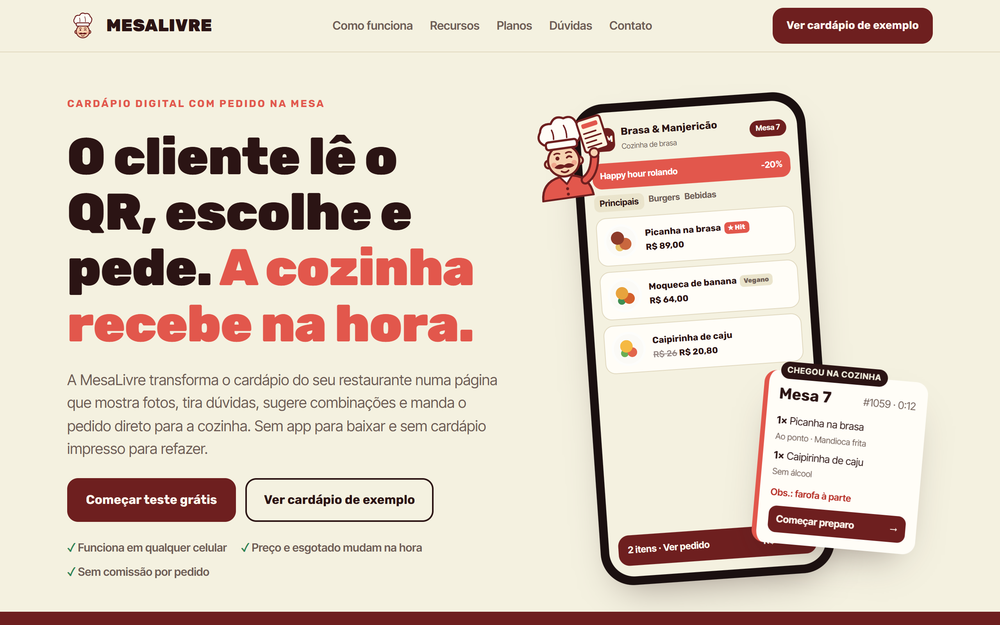
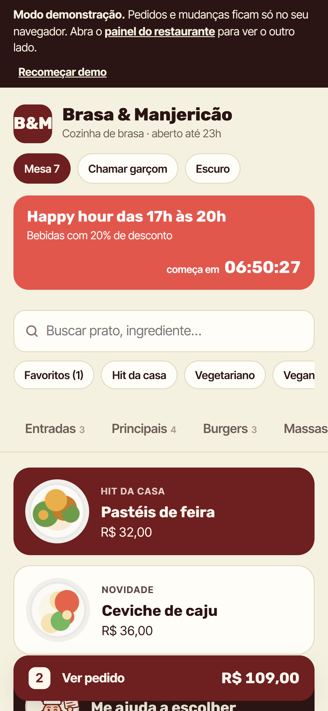
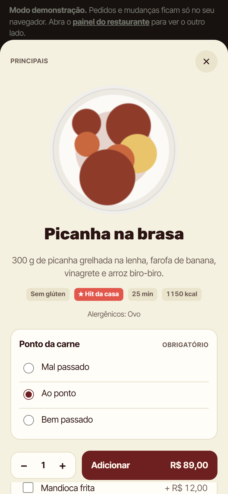
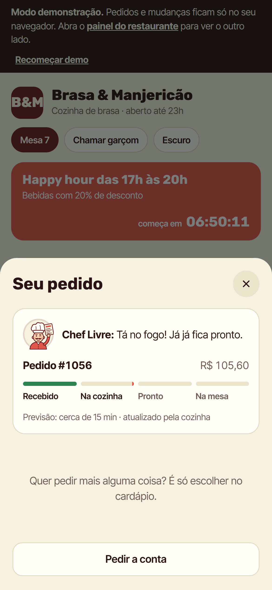
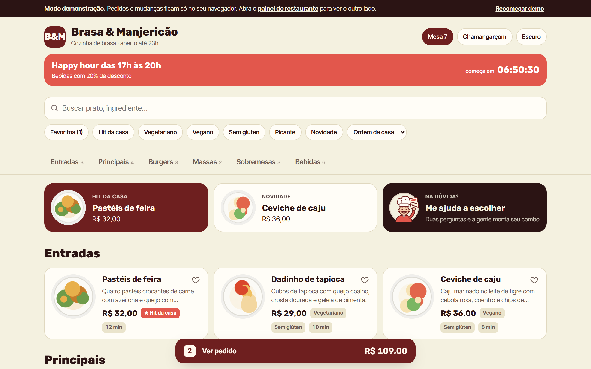
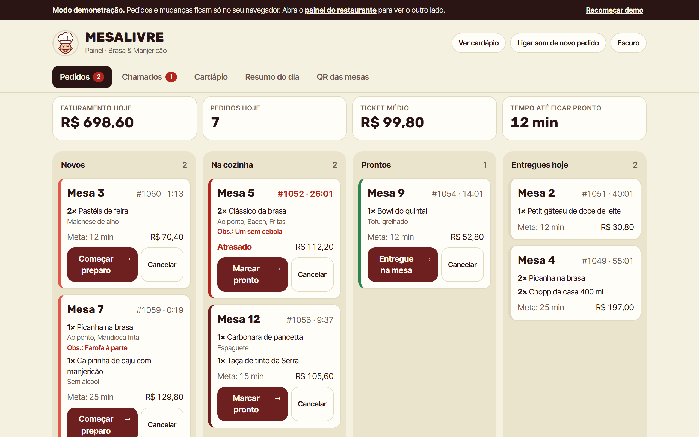
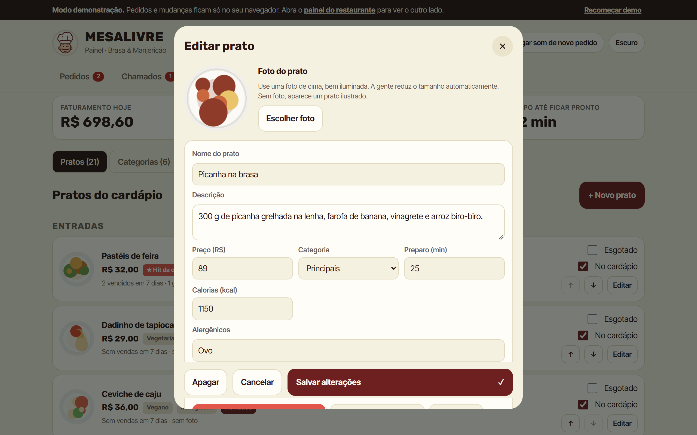

# MesaLivre

Cardápio digital com pedido na mesa. O cliente lê o QR code da mesa, escolhe os pratos no celular e envia o pedido. A cozinha recebe na hora num painel ao vivo.

**[Ver o site](https://larissadefarias.github.io/mesalivre/)** · **[Abrir o cardápio](https://larissadefarias.github.io/mesalivre/cardapio.html#mesa-7)** · **[Abrir o painel do restaurante](https://larissadefarias.github.io/mesalivre/cardapio.html#painel)**

O projeto roda em **modo demonstração**: os pratos de exemplo já vêm carregados e os pedidos ficam salvos no navegador de quem está testando. Faça um pedido no cardápio e acompanhe ele chegar no painel.



## Telas

### Cliente

<p>
  
  
  
</p>



### Restaurante

**Painel da cozinha:** pedidos em colunas, cronômetro, alerta de atraso e resumo do dia.



**Cadastro do cardápio:** pratos, fotos, selos, adicionais e disponibilidade.



## Páginas

| Arquivo | O que é |
|---|---|
| `index.html` | Página de vendas da MesaLivre: recursos, demonstração, planos, dúvidas e contato por WhatsApp |
| `cardapio.html` | O produto: cardápio do cliente (`cardapio.html`) e painel do restaurante (`cardapio.html#painel`) |
| `logos.html` | Estudo de identidade visual: três caminhos de logo, incluindo o mascote Chef Livre |

## Recursos

**Para o cliente**
- Cardápio com fotos, busca sem acento, filtros (vegetariano, vegano, sem glúten, picante, novidade, Hit da casa) e favoritos
- Selo **★ Hit da casa** para os pratos que mais saem
- Opções e adicionais com preço (ponto da carne, extras), observações e sugestões de "combina com"
- "Me ajuda a escolher": duas perguntas e o Chef Livre sugere prato e bebida
- Carrinho com cupom, serviço opcional de 10% e divisão da conta
- Mesa preenchida pelo QR code (`cardapio.html#mesa-7`), chamar garçom e pedir a conta
- Acompanhamento do pedido ao vivo, com mensagens do Chef Livre
- Happy hour automático com contagem regressiva
- Tema claro e escuro

**Para o restaurante (painel)**
- Quadro da cozinha: Novos, Na cozinha, Prontos, Entregues, com cronômetro, alerta de atraso e aviso sonoro
- Chamados das mesas (garçom e conta)
- Cadastro completo do cardápio: pratos, fotos, selos, adicionais, ordem, esgotado e visibilidade
- Categorias com ordem e happy hour por categoria
- Dados do restaurante, WhatsApp e regras do happy hour
- Sugestão automática de Hit da casa com base nas vendas dos últimos 7 dias
- Resumo do dia: faturamento, ticket médio, tempo de preparo, pratos mais pedidos e pedidos por hora
- QR code de cada mesa, pronto para imprimir

## Tecnologia

- HTML, CSS e JavaScript em arquivos únicos, sem etapa de build
- React 18 com [htm](https://github.com/developit/htm) (JSX sem compilador), carregados por CDN
- [qrcode-generator](https://github.com/kazuhikoarase/qrcode-generator) para os QR codes das mesas
- Dados: camada de banco de documentos em tempo real (coleções, `onSnapshot`) simulada em `localStorage`, pronta para ser trocada por um backend real
- Fontes Rubik e Inter Tight (Google Fonts)

## Rodar localmente

Qualquer servidor de arquivos estáticos funciona. Com Python:

```bash
python -m http.server 8000
```

Depois abra `http://localhost:8000`. Para zerar a demonstração, use o botão **Recomeçar demo** na faixa do topo do cardápio.

## Publicar no GitHub Pages

Em **Settings → Pages**, escolha a branch `main` e a pasta raiz. A página de vendas fica no endereço principal e o cardápio em `/cardapio.html`.

## Licença

Este projeto usa a licença [PolyForm Noncommercial 1.0.0](LICENSE.md).

- **Pode:** ver o código, estudar, testar e adaptar para uso pessoal, estudo ou pesquisa, sem fins lucrativos.
- **Não pode:** usar, vender, revender ou oferecer o projeto (ou uma versão modificada dele) para fins comerciais, como cobrar de restaurantes pelo uso.

Para uso comercial, entre em contato com a autora.

Copyright (c) 2026 [larissadefarias](https://github.com/larissadefarias)
